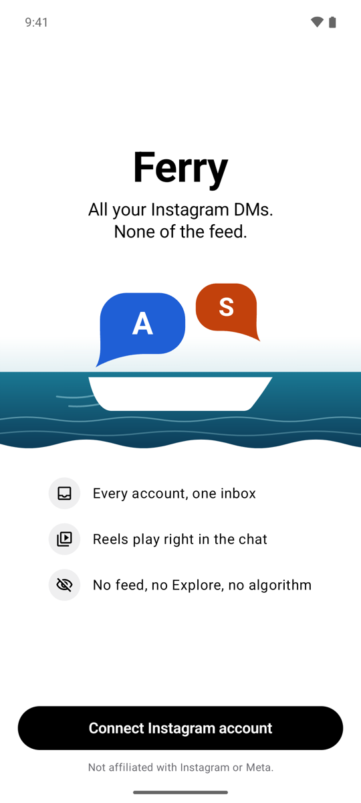
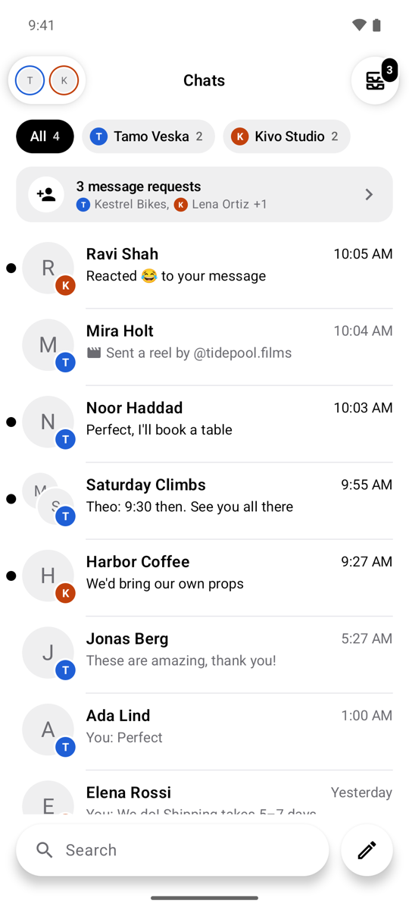
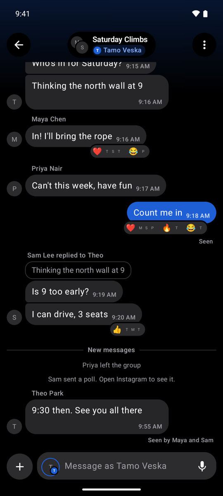
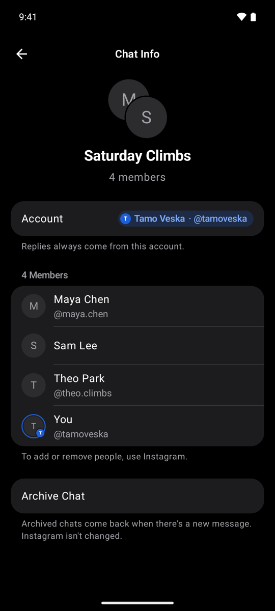

# Ferry Messenger for Android

Ferry Messenger is an Android app for your Instagram direct messages and nothing else. All your Instagram accounts in
one inbox, and no feed, no Explore, no algorithm. It's the Android version of
[Ferry Messenger](https://github.com/luisten/ferry-messenger) for iPhone.

  
  
  
  

Made-up accounts and chats, on the Android emulator.

## What it does

- **All your accounts in one inbox.** Give each account a name, a colour and a letter, so you always know which
  account a chat belongs to. Tap an account to see only its chats.
- **Replies always come from the right account.** Every chat stays with the account it belongs to.
- **Everything you'd expect in a chat:** replies, reactions, edits, unsending, typing and "Seen". Swipe a message to
  reply to it.
- **Photos, videos, voice notes and GIFs,** sent and received, several photos and videos at once or one straight
  from the camera. Shared reels play right in the chat.
- **Notifications** for new messages, also while the app is closed.
- **Message requests,** opened without sending "Seen". Accept or delete them when you're ready.
- **Primary and General** for business and creator accounts, plus an archive for chats you're done with.
- Light and dark mode.

## How it works

Ferry Messenger talks to Instagram directly from your phone, the same way Instagram's website does. There's no
server and no account to create: nothing sits between you and Instagram.

## Privacy

- You log in on Instagram's own login page, inside the app. The app never sees or stores your password.
- Your Instagram session stays on your phone, locked with a key that can't leave it. It isn't part of your phone's
  backups.
- The app talks only to Instagram.
- No analytics and no tracking.

## Good to know

- **Notifications need the app connected.** Ferry Messenger stays connected to Instagram in the background and shows
  a quiet "Connected" notification for it. Some phones' battery savers stop that; the app's Accounts screen offers
  the exemption.
- **Instagram's end-to-end encrypted chats** can't be shown; open those in Instagram.
- **It's unofficial.** Instagram can change how its website works, and it may ask you to confirm a new login in the
  Instagram app. Do your first logins on your home Wi-Fi.
- **A small risk to your account.** Instagram doesn't approve of unofficial apps, and it can restrict or ban
  accounts it thinks are automated. Ferry Messenger uses Instagram the way its website does, from your own phone, so
  the risk is small, but it isn't zero. Unlike the iPhone app it stays connected while it's closed, and how Instagram
  takes that over months isn't known yet.
- **It's young.** It has been checked on the Android emulator, not yet on many real phones or with the TalkBack
  screen reader, and very large text sizes crowd a few screens.

Ferry Messenger is not affiliated with Instagram or Meta.

## Install

Ferry Messenger isn't on Google Play, so you install it yourself. You need a phone with Android 8.0 or newer and a
64-bit ARM processor (nearly every phone of the last years).

- **From the release:** on your phone, download the `.apk` file from the
  [latest release](https://github.com/luisten/ferry-android/releases/latest) and open it. Android asks you to allow
  the install; [docs/INSTALL.md](docs/INSTALL.md) shows each step, and how to check the file is the developer's.
- **From the source code:** `./gradlew assembleDebug` builds it, with JDK 21, the Android SDK and NDK, and Go 1.27.3
  for the engine. [The pipeline](.github/workflows/ci.yml) shows the exact versions, and [CLAUDE.md](CLAUDE.md) the
  commands.

Updates install the same way, over the old version; your accounts and chats stay.

## For developers

The app is Kotlin and Jetpack Compose on the iPhone app's engine (Go, in
[its repository](https://github.com/luisten/ferry-messenger)). How it's built and tested: [CLAUDE.md](CLAUDE.md).
Why things are the way they are, and what's still open: [docs/DECISIONS.md](docs/DECISIONS.md). What changed in each
version: [CHANGELOG.md](CHANGELOG.md).

## Licence

Ferry Messenger is under the [GNU AGPL-3.0](LICENSE), like the iPhone app, because it uses
[mautrix](https://github.com/mautrix/meta)'s Instagram library, which is AGPL-3.0. If you give the app to other
people, the AGPL asks you to offer them its source code too.
